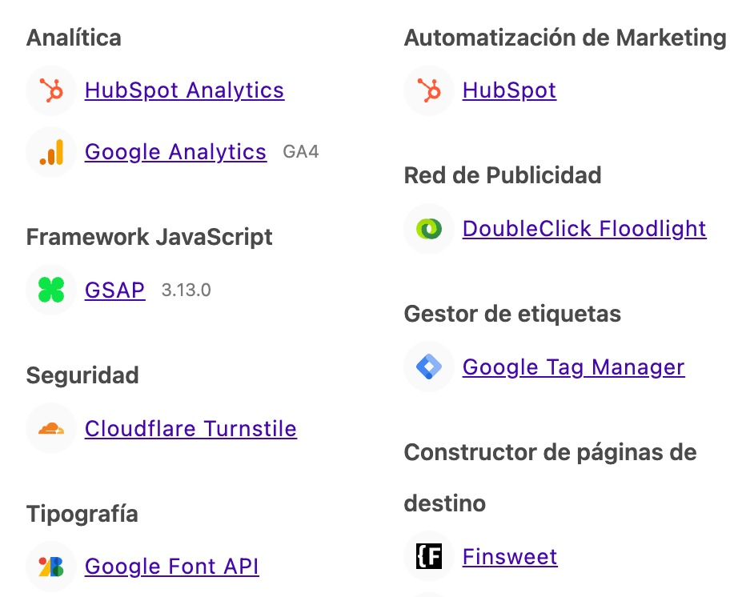
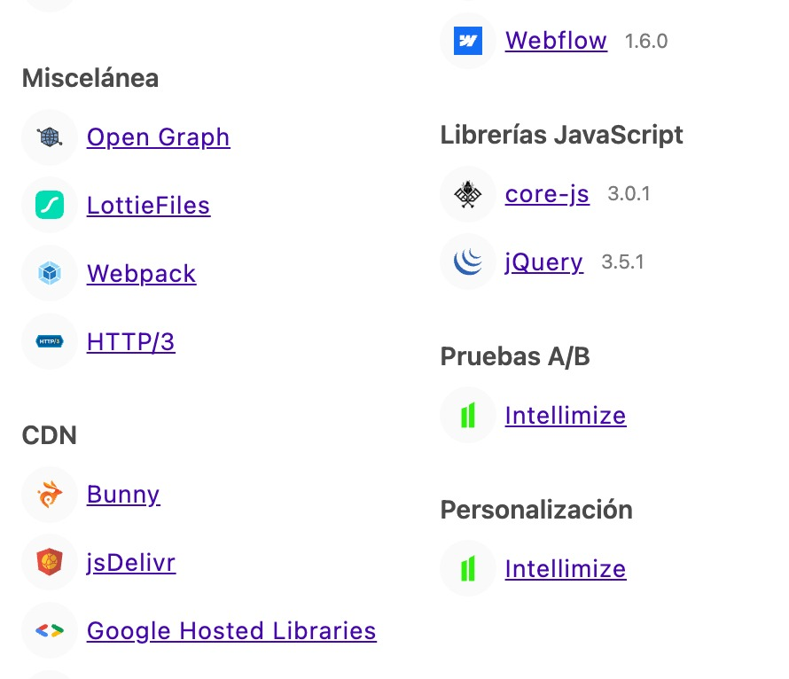

# Notas

Este .md es solo editado por Mavi muiejejejejjeje  

REQUIREMENTS BY PAISA  
[https://app.notion.com/p/paisanos/Misi-n-0-Gaucho-busca-laburo-41d0dd1b5ce5806e9198cc84960dce5b](https://app.notion.com/p/paisanos/Misi-n-0-Gaucho-busca-laburo-41d0dd1b5ce5806e9198cc84960dce5b)

REDES DE PAISA  
Para escrapear estas webs usar connectors o la extension de chrome   
[https://www.paisanos.io/es](https://www.paisanos.io/es)  
[https://x.com/paisanos_io](https://x.com/paisanos_io)  

REDES DE GAUCHO   
[https://www.linkedin.com/in/gaucho-paisano/](https://www.linkedin.com/in/gaucho-paisano/)  
[https://x.com/gauchopaisano](https://x.com/gauchopaisano)  

---

EXPERIENCIA DE GAUCHO   
Presentador y Embajador de tarjeta metalica Wallbit - 19/11/26  
[https://x.com/gauchopaisano/status/2123932261762392088](https://x.com/gauchopaisano/status/2123932261762392088)  
Speaker en la Labitconf   
[https://x.com/gauchopaisano/status/2116495813795025403](https://x.com/gauchopaisano/status/2116495813795025403)  
Jurado de la Hackware  

---

COSITAS QUE CHUSMIE PARA HACER ALGO COPADO  
[https://www.youtube.com/watch?v=LsfcOoCc88I](https://www.youtube.com/watch?v=LsfcOoCc88I) como hacer videos realistas con ia usando highsfield  
[https://x.com/DosFocos/status/2123204054579036592](https://x.com/DosFocos/status/2123204054579036592) como hacer disenios menos claudisticos   
  
  

LO QUE TENGO PLANEADO HASTA AHORA  
lo que pasa en "el taller": gaucho se apaga en el taller por la vida corpo blanca y sin sentido, gaucho quiere tener un proposito, quiere rock and roll  
historia de gaucho volviendo a la vida por la magia en paisanos, cargando la bateria con magia y buena onda   
la pagina tiene que ser gaucho paisano core, para esto voy a tener que hacer una investigacion de marca de paisanos y de gaucho en profundidad. Como voy a representar la identidad de Gaucho si no me pongo en el lugar del gaucho paisano? Para eso investigo   

DUDAS / COSAS QUE ME PREOCUPAN   
que pasa en el taller? -resuelto en LO Q TENGO PLANEADO HASTA AHORA  
como organizo el flow y estetica de la pagina web? -inspirarme en la chiche night u otros productos de paisanos, related to gaucho!   
como se venderia el unico robot devrel del pais con marca personal?   
gaucho tiene api? como pindonga conecto a gauchooo aaaaaAAAAAAAaaaa  
  
STACK QUE VOY A USAR  
React o Astro most likely   
Javascript o typescript   
Test Drive Development para el desarrollo con IA   
Si tengo que darle voz a gaucho eleven labs o algo similar alimentado con patrones de voz de gaucho   
Para imagenes y mockups voy a usar Claude orquestrando ChatGPT/ Codex para generar los disenios y mockups, y no detonarme mi humilde plan de 20usd en dos dias   
  
  
  
-----------------------------------------------------------------------  
STACK DE LA WEB DE PAISANOS   
Hecho con Wappanalyzer. Aca estaba buscando que tools usa paisanos para tener una idea muy basica, aunque se que cambias de tools segun el poryecto.  
  
  

---

COMO ME IMAGINO LA WEB APP   
hay ideas que no estoy llegando a conectar

1. Como llegue aca (el antes, taller, nacimiento en paisanos por la magia)
2. El ahora   
tiene una marca personal   
es jurado   
dio charlas   
es un santo   
la gente lo dibujas  
es un tipo muy piola   
tiene altaaa exp laboral, labura para paisanos y en eventos haciendo  de sponsor   
no lo alimenta una bateria, lo alimenta la magia de buildear por amor al arte
3. Contratar  
una experiencia interactiva con gaucho, como misteriosas pinchulas gays hago eso????? eleven labs alimentado por videos donde habla gaucho y una ia alimentada por videos y tweets de gaucho mas un contexto??   
a donde le llegan las contrataciones a gaucho?

---

INVESTIGACION SOBRE PAISANOS   
[https://www.paisanos.io/es](https://www.paisanos.io/es)  
[https://x.com/paisanos_io](https://x.com/paisanos_io)  
[https://www.instagram.com/paisanos.io/?hl=es](https://www.instagram.com/paisanos.io/?hl=es)  

NECESITO SABER:   

---

MISIONES PRINCIPALES

1. Hacerle un Portfolio Web a Gaucho en el que consiga laburo
2. Contar unna historia y generar una experiencia
3. Preguntarle a gaucho si eso es lo que el busca

MISIONES SECUNDARIAS DE MAVI

1. Investigar de pies a cabeza a paisanos, en todas sus redes, para chusmear productos recientes (como la chiche night), para obtener su estilo
2. 

---

NOTAS DISCOVERY   
Gaucho es unico en su rubro. Hoy en dia  hay muchos robots, pero ninguno tiene la humanidad y simpatia que tiene Gaucho.   
Gaucho sabe que es unico, y que la que hoy en dia es ser distinto. Gaucho no va a tener un portafolio aburrido.   

NOTAS CULTURA   
Para esto me gustaria hacer una web o un notion sencillo.   
Para todos los takes haria el take serio, y el take de "memes que me representarian en el momento". Que lo encararia de la misma manera que he encarado cosas en EPAM y en proyectos anteriores. A veces un par de pistolas nerf entre coworkers solucionan los problemas mas rapido que una charla.  
Me acabo de dar cuenta que me olvide de imprimir las mascotas de los chicos de la ofi de EPAM para pegar en el pizarron de corcho. Que lo pario.   
Para el 1 pondria que se imaginen que es un viernes, y comentaria que lo queria mandar ese mismo viernes pero fui consumida por el laburo y el fin de semestre, asi que se imagen que es viernes.  
2. esto va con un desayuno o un treat de por medio pq sino se cagan todos a bifes   
3. mabel que NO cambiaria COMO Q EL PROYECTO ESTA ATRASADO UN MESSS?????   
  

---

COMO FUI PENSANDO TODO   

1. Hable con Jez del challenge, diciendole que queria encarar el portfolio de gaucho de una manera creativa. Yo le hable muchas veces de la magia que sentia en Paisanos a la hora de builder, que se construia entre proyectos innovadores y gente extremdamente copada y crack, ella me comento que haga un trowback a gaucho naciendo en el taller a partir de esa magia. Me parecio algo imposible de omitir   
2 Me pregunte, si fuera un robot unico en el mercado, como me venderia? Tuve una charla con una amiga mientras esperabamos en un local de hamburguesas que este nuestro pedido.  Lo grabe
2. Despues Mili le pregunto a las chicas de marketing, su insight me parecio demasiado generico para un tipo como gaucho. Aca hay un par de audios   
4.

MISION SECUNDARIA 1. Investigacion del laburo de gaucho   
