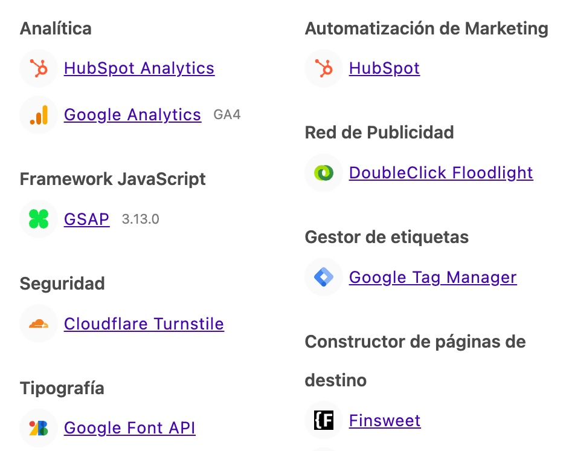
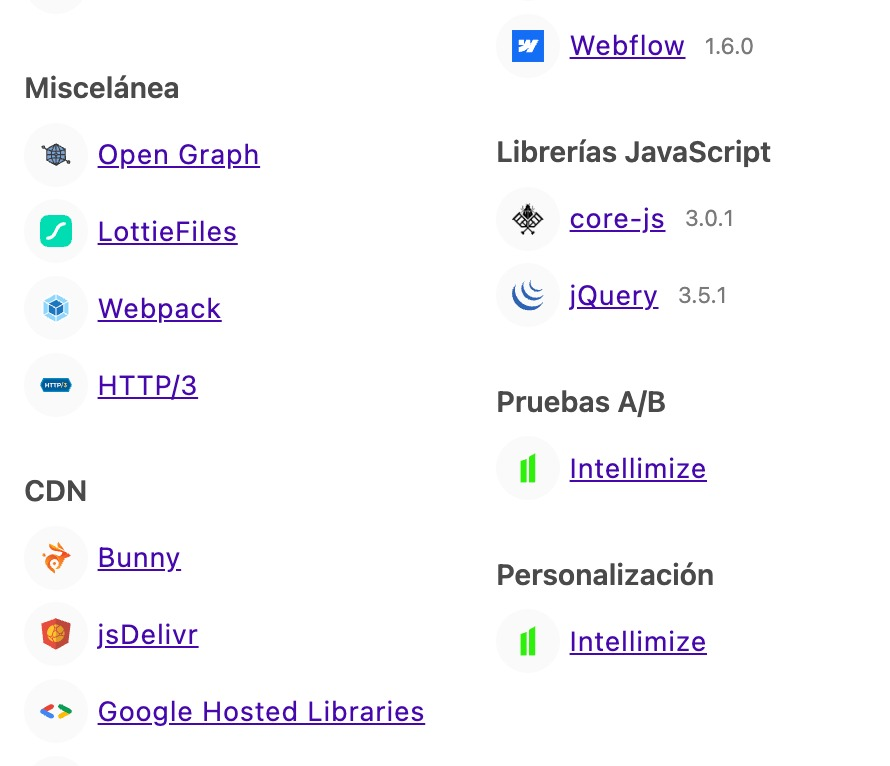

# Notas

Este .md es solo editado por Mavi muiejejejejjeje  

REQUIREMENTS BY PAISA  
[https://app.notion.com/p/paisanos/Misi-n-0-Gaucho-busca-laburo-41d0dd1b5ce5806e9198cc84960dce5b](https://app.notion.com/p/paisanos/Misi-n-0-Gaucho-busca-laburo-41d0dd1b5ce5806e9198cc84960dce5b)

REDES DE PAISA  
Para escrapear estas webs usar connectors o la extension de chrome   
[https://www.paisanos.io/es](https://www.paisanos.io/es)  
[https://x.com/paisanos_io](https://x.com/paisanos_io)  
[https://www.instagram.com/paisanos.io/?hl=es](https://www.instagram.com/paisanos.io/?hl=es)  

REDES DE GAUCHO   
[https://www.linkedin.com/in/gaucho-paisano/](https://www.linkedin.com/in/gaucho-paisano/)  
[https://x.com/gauchopaisano](https://x.com/gauchopaisano)  

---

EXPERIENCIA DE GAUCHO   
Presentador y Embajador de tarjeta metalica Wallbit - 19/11/26  
[https://x.com/gauchopaisano/status/2123932261762392088](https://x.com/gauchopaisano/status/2123932261762392088)  
Speaker en la Labitconf   
[https://x.com/gauchopaisano/status/2116495813795025403](https://x.com/gauchopaisano/status/2116495813795025403)  
Jurado de la Hackware  

---

COSITAS QUE CHUSMIE PARA HACER ALGO COPADO  
[https://www.youtube.com/watch?v=LsfcOoCc88I](https://www.youtube.com/watch?v=LsfcOoCc88I) como hacer videos realistas con ia usando highsfield  
[https://x.com/DosFocos/status/2123204054579036592](https://x.com/DosFocos/status/2123204054579036592) como hacer disenios menos claudisticos   

LO QUE TENGO PLANEADO HASTA AHORA  

- lo que pasa en "el taller": gaucho se apaga en el taller por la vida corpo blanca y sin sentido, gaucho quiere tener un proposito, quiere rock and roll  
- historia de gaucho volviendo a la vida por la magia en paisanos, cargando la bateria con magia y buena onda   
- la pagina tiene que ser gaucho paisano core, para esto voy a tener que hacer una investigacion de marca de paisanos y de gaucho en profundidad. Como voy a representar la identidad de Gaucho si no me pongo en el lugar del gaucho paisano? Para eso investigo   
- a gaucho lo contratan de otras empresas para eventos, colaboraciones, proyectos piolas y demas, pero gaucho sigue laburando en paisanos!!   
- easter egg: videito de gaucho con la estetica retro marcada y medio historieta o pixel art que lo caracteriza, haciendo el check de "no soy un robot" usando la extension de chrome de claude para aplicar a un laburo en linkedin jajajajajjaaj   
- easter egg: gaucho en sus primeros dias de laburo: detona la maquina de cafe; le dice boludo a uno; se queda sin bateria mientras trabaja y todos piensan que se puso a dormir; le hace cortocircuito el brazo, abre su garrita mecanica y se le cae el cafe que recien se sirvio; se lleva puesta la mesa y tira una mac  
- quiero conseguirle un laburito a gaucho, de verdad, como genero esa traccion? como llego a nuevas empresas?   
- una idea que se me habia ocurrido es hacerle un tik tok a gaucho y que haga el challenge de "dia 1 buscando laburo hasta que lo encuentre", donde sube un video todos los dias hasta que alguien lo contrata posta   
- me gustaria tener una meeting con gaucho, y preguntarle varias cositas

   

DUDAS / COSAS QUE ME PREOCUPAN   
que pasa en el taller? -resuelto en LO Q TENGO PLANEADO HASTA AHORA  
como organizo el flow y estetica de la pagina web? -inspirarme en la chiche night u otros productos de paisanos, related to gaucho!   
como se venderia el unico robot devrel del pais con marca personal?   
gaucho tiene api? como pindonga conecto a gauchooo aaaaaAAAAAAAaaaa  
como hago para conseguirle un laburito a gaucho? de verdad, que genere traccion, impacto, que tenga alcance y que genere nuevos leads  

STACK QUE VOY A USAR  
React o Astro most likely   
Javascript o typescript   
Voy a usar Test Drive Development para el desarrollo con IA   
Si tengo que darle voz a gaucho eleven labs o algo similar alimentado con patrones de voz de gaucho   
Para imagenes y mockups voy a usar Claude orquestrando ChatGPT/ Codex para generar los disenios y mockups, y no detonarme mi humilde plan de 20usd en dos dias   
Arranca todo con una investigacion de imagen de marca, prosigue con mock ups de como me gustaria que se vea la estetica,   

---

STACK DE LA WEB DE PAISANOS   
Hecho con Wappanalyzer. Aca estaba buscando que tools usa paisanos para tener una idea muy basica, aunque se que cambias de tools segun el poryecto.  

  

---

COMO ME IMAGINO LA WEB APP   
hay ideas que no estoy llegando a conectar

1. Como llegue aca (el antes, taller, nacimiento en paisanos por la magia)
2. El ahora   
tiene una marca personal   
es jurado   
dio charlas   
es un santo   
la gente lo dibujas  
es un tipo muy piola   
tiene su propio juego, el gaucho adventures   
tiene su propio corto, gaucho los origines    
tiene altaaa exp laboral, labura para paisanos y en eventos haciendo  de sponsor   
no lo alimenta una bateria, lo alimenta la magia de buildear por amor al arte
3. Contratar  
una experiencia interactiva con gaucho, como misteriosas pinchulas gays hago eso????? eleven labs alimentado por videos donde habla gaucho y una ia alimentada por videos y tweets de gaucho mas un contexto??   
a donde le llegan las contrataciones a gaucho?

---

INVESTIGACION SOBRE PAISANOS   
[https://www.paisanos.io/es](https://www.paisanos.io/es)  
[https://x.com/paisanos_io](https://x.com/paisanos_io)  
[https://www.instagram.com/paisanos.io/?hl=es](https://www.instagram.com/paisanos.io/?hl=es)  

---

MISIONES PRINCIPALES

1. Hacerle un Portfolio Web a Gaucho en el que consiga laburo
2. Contar unna historia y generar una experiencia
3. Preguntarle a gaucho si eso es lo que el busca

MISIONES SECUNDARIAS DE MAVI

1. Investigar de pies a cabeza a paisanos, en todas sus redes, para chusmear productos recientes (como la chiche night), para obtener su estilo
2. 

---

NOTAS sobre DISCOVERY   
Gaucho es unico en su rubro. Hoy en dia  hay muchos robots, pero ninguno tiene la humanidad y simpatia que tiene Gaucho.   
Gaucho sabe que es unico, y que la que hoy en dia es ser distinto. Gaucho no va a tener un portafolio aburrido.   

NOTAS sobre CULTURA   
Para esto me gustaria hacer una web o un notion sencillo.   
Para todos los takes haria el take serio, y el take de "memes que me representarian en el momento". Que lo encararia de la misma manera que he encarado cosas en EPAM y en proyectos anteriores. A veces un par de pistolas nerf entre coworkers solucionan los problemas mas rapido que una charla.  
Me acabo de dar cuenta que me olvide de imprimir las mascotas de los chicos de la ofi de EPAM para pegar en el pizarron de corcho. Que lo pario.   
Para el 1 pondria que se imaginen que es un viernes, y comentaria que lo queria mandar ese mismo viernes pero fui consumida por el laburo y el fin de semestre, asi que se imagen que es viernes.  
2. esto va con un desayuno o un treat de por medio pq sino se cagan todos a bifes   
3. mabel que NO cambiaria COMO Q EL PROYECTO ESTA ATRASADO UN MESSS?????   
  

---

COMO FUI PENSANDO TODO/ MI PROCESO CREATIVO / COSAS QUE FUERON PASANDO EN MEDIO

- Lo maquine desde el lunes, aunque arranque a hacer mockups y plasmar ideas recien el domingo. Fue una semana muy larga, y no queria levantar un MVP con la cabeza completamente quemada y el cuerpo totalmente cansado. 
- Hable con Jez del challenge, diciendole que queria encarar el portfolio de gaucho de una manera creativa. Yo le hable muchas veces de la magia que sentia en Paisanos a la hora de buildear, que se construia entre proyectos innovadores y gente extremadamente copada y crack, ella me comento que haga un throwback de gaucho naciendo en el taller a partir de esa magia. Me parecio algo imposible de omitir.
- Me di cuenta que estaba desafiando mucho los limites, normativas y alcance del challenge. No queria hacer una webapp donde solo pudiera entrevistar a Gaucho, queria algo que genuinamente genera impacto, que sea escalable, que le sirva a gaucho, que lo vea la gente, que gaucho consiga laburo. Validar si Gaucho, que ya tiene una marca personal, es mucho mas que el "robot de paisanos" y es, en efecto, Gaucho paisano. Y puede expandirse como tal usando esa marca personal. Me di cuenta que me estaba yendo un poco a la mierda. Me acorde que Nacho y Sofi me dijeron que una de las caracteristicas de los paisanos es que alguien venia con un proyecto y se terminaba quedando con 5 mas por esas mismas caracteristicas por las que yo sentia que "me estaba yendo a la mierda" 
- Me di cuenta que el portfolio tiene que ser algo extraordinario, y no solo quedarse en la webapp, sino ir mas alla, generar traccion, desplegar una campania creativa, volverse algo mucho mas grande. Porque Gaucho no es un robot convencional, y yo tampoco soy una tipa convencional
- Me pregunte, si fuera un robot unico en el mercado, como me venderia? Tuve una charla con una amiga Mili mientras esperabamos en un local de hamburguesas que este nuestro pedido.  Lo grabe. Me dio consejos muy convencionales
- Despues Mili le pregunto a las chicas de marketing, su insight me parecio demasiado generico para un tipo como gaucho. Aca hay un par de audios
- Me dio una crisis de "Y si nos les gusta?". Mi circulo cercano me reconforto con que literalmente me dieron a su hijo como challenge, que eso demostraba que me tienen confianza y que saben que voy a hacer algo bueno. 
- Aca empece a materializar la idea.
- En el medio de esto se me rompio el mouse, tambien el teclado, y mi mousepad ha visto dias mejores (se sortea gato de 3 meses, pesa 1.5kg, peludito y mansito, muy mimoso, como plus se llama Delirio. disclaimer: el seguro para hogar no viene incluido con el michi). Compre teclado y mouse nuevos, pero no habia ningun mousepad que me gustara la estetica. Queria algo creativo en vez de solo estetico. Algo que represente un poco las cosas que me gusten y me represente a mi tambien. En el medio de mi delirio mistico de pensar mucho para el challenge decidi que quiero un mousepad de Gaucho, estilo historieta, que voy a generar yo mientras haga la investigacion creativa para el estilo de arte de los easter eggs. 
- Me gustaria validar con el equipo, que piensa, como encararian la situacion, que cambiarian. Para mi mas que un challenge en mi Mision 0 en Paisanos, la primera cosita que voy a hacer como parte del equipo, aunque todavia no oficialmente (como diria yo, como "moto robada"). Asi que es una excelente oportunidad para conocerlos
- Pienso constantemente en que ojala se acuerden que yo avise que era culo inquieto. El que avisa no traiciona. 
- Lunes 4am, me acabo de enterar que existe el video **Gaucho**: El Origen, no se como pindorcha voy a hacer yo para generar contenido de semejante calidad. Puedo preguntar, puedo averiguarlo, se que lo voy a poder hacer. 
- Identificacion de oportunidad post crisis de como pindorcha estar a la altura: Hay una historia de los origenes de Gaucho by Paisa. Pero hay un gap en la historia de Gaucho, esta el como lo revivieron desde el POV de paisanos, no desde el POV de gaucho.
- Ah, me quiero hacer la estampita de chinita! 
- Hay que mejorar el **SEO** (*Search Engine Optimization*) para que uno encuentre a Gaucho cuando uno busca robot Gaucho Paisanos, pq me aparecen puros gauchos y no el robot  
- A veces se me van las ganas de sortear a Delirio, es muy compañero (aunque se tome demasiado literal la definicion de mouse y trate de cazarlo)
- Le hable Gonza para probar el juego  de Gaucho, me gano el fomo 
- Le voy a preguntar a sofi si es legal que me pase el archivo con la personalidad de gaucho, o me conecte una api a gaucho para la entrevista |
- Estoy pensando en replicar exactamente el mismo sistema tecnico que tiene gaucho segun lo que se de los videos 
- Acabo de ver el [https://a-better-byte.vercel.app/](https://a-better-byte.vercel.app/) ,  que hizo Sofi, me lei todos los poemas. Me gusto mucho la bronca y desdicha del autor, como en "**my first computer poem"** o en **"a computer now".** Siento que va mucho de la mano de las sensacion que tiene uno la primera vez que empieza a usar una computadora. Tuve la misma desdicha e emocion cuando muy chica empece a usarlas, y no entendia un pomo. Hoy en dia una le puede preguntar a la ia. La computadora que yo tenia era un cuadrado blanco, que no tenia internet, y con suerte tenia encarta y un programa que parecia Paint en drogas (muy literalmente), Que linda la estetica de la experiencia, y que lindos los sonidos. No conocia a Charles Bukowski 
- Estuve jugando con el [https://gaucho-studio.vercel.app/](https://gaucho-studio.vercel.app/) , hice un gaucho chaquenio cuidado las vacas, esto tambien va a ser un videito easter egg
- Yo lo amo a Gaucho, pero por dios devuelvanlo a la fonoaudiologa que me cuesta mas entenderle a el el espaniol que a un Australiano el ingles con acento curseado
- Claudio por alguna razon falopa me tirro "gaucho te entrevista a vos", y me gusto. Le da un toque desafiante y medio mandado, bien gauchezco.
- Hoy ya es Martes, habia dicho que esta semana iba a soñar con Gaucho. Dicho y hecho. Anoche soñe con la solucion de como queria que se viera el portfolio. "Tanto el conflicto como la solucion estan dentro."
- Me di cuenta que estaria bueno sumar las paletas de marca, unos disenios, hacer un figma bien lindo
- Tambien me di cuenta que paisanos hace [un caso de estudio](https://www.paisanos.io/es/projects/switch-website-case-study) por cada empresa y/o producto que hace, asi que yo voy a hacer uno tambien :D. Es la primera vez que hago un caso de estudio, voey a aprender como 
- Antes de empezar la pagina voy a terminar de diseniar el design kit, y voy a darle una web de referencia. Quiero pegar un level up lindo en disenio. Y no que sea un ai slop como el de Pacta.  

